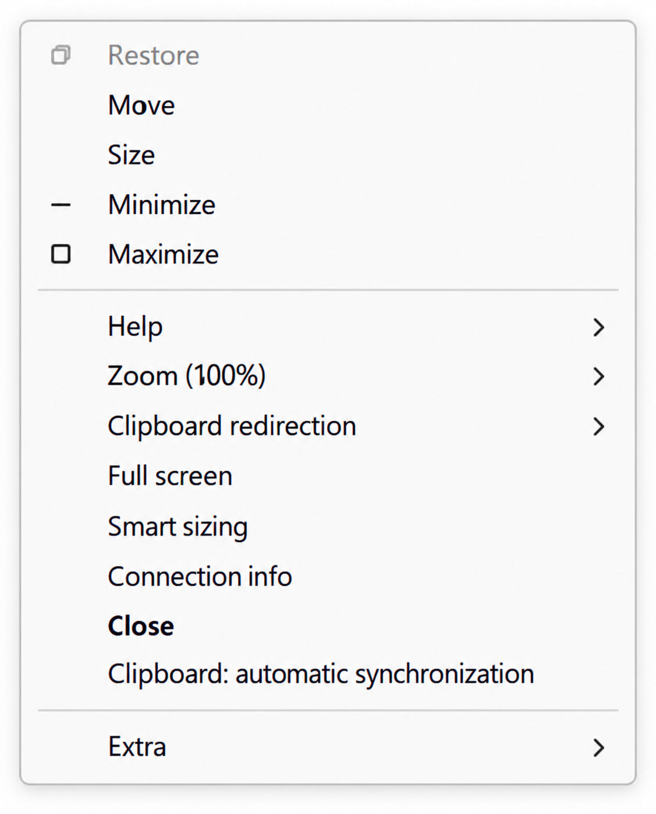

# RDP Clipboard On/Off in microsoft remote desktop (mstsc.exe)

[Русская версия](README.ru.md)

A privacy-focused launcher for Microsoft Remote Desktop Connection. It keeps the familiar `mstsc.exe` interface,
`.rdp` profiles, and Microsoft RDP engine, while adding a live switch for clipboard synchronization.

Each new connection starts with automatic clipboard synchronization **off**. Enable it only when you intentionally
need to copy data between the local and remote computers.

> Privacy rule: keep clipboard synchronization off by default and turn it on only for the transfer you need.



This project is a focused fork of [Devolutions/MsRdpEx](https://github.com/Devolutions/MsRdpEx).

## How it works

- `mstscex.exe` starts the original Microsoft `mstsc.exe` through `MsRdpEx.dll`.
- The normal MSTSC settings window and its built-in features remain available.
- The Microsoft RDP ActiveX manual clipboard mode is enabled before connecting.
- Automatic synchronization is disabled at the start of every connection.
- The connection window system menu contains **Clipboard: automatic synchronization**.
- Unchecked means off; checked means on.
- Manual clipboard mode remains active for the whole connection. When the switch is checked, the local clipboard is
  sent when the RDP window gains focus, and the remote clipboard is received when the RDP window loses focus.
- Synchronizing on focus changes avoids continuous polling, which can interrupt delayed file clipboard transfers.

The normal **Local Resources → Clipboard** option must remain enabled. It is the RDP capability gate; the new switch
controls when synchronization is active during the session.

## Build and install

Requirements: Windows 10/11, Visual Studio 2022 with **Desktop development with C++**, and CMake.

```powershell
cmake -G "Visual Studio 17 2022" -A x64 -DWITH_DOTNET=OFF -B build-x64
cmake --build build-x64 --config Release
powershell -NoProfile -ExecutionPolicy Bypass -File .\scripts\package-clipboard-onoff.ps1
```

The ready-to-copy package is created in `dist\mstsc-clipboard-onoff`. Keep `mstscex.exe` and `MsRdpEx.dll` in the
same directory, then run:

```powershell
cd .\dist\mstsc-clipboard-onoff
.\Register-RDP-App.cmd
```

Windows Settings opens because Windows requires the user to choose the default application for `.rdp` files. Select
**MSTSC Clipboard On/Off**. Registration affects only the current Windows user and does not require administrator
rights.

## Use

1. Open an `.rdp` file with **MSTSC Clipboard On/Off**.
2. Connect normally using the familiar MSTSC interface.
3. Open the connection window system menu with `Alt+Space`, or right-click the full-screen connection bar.
4. Only when a transfer is needed, select **Clipboard: automatic synchronization** to turn synchronization on.
5. Local to remote: copy locally, switch to the RDP window, and paste.
6. Remote to local: copy in RDP, switch to a local application, and paste.
7. For files, wait until the copy operation has completed, then turn synchronization off again.

Every new connection starts unchecked. Turning the switch off stops later synchronization; it does not erase data
already present in either clipboard.

## Edit an RDP profile

The registration script also creates **Send to → Edit RDP**. It opens the selected file in the original Microsoft
RDP settings editor (`mstsc.exe -edit`) without changing the default application.

On Windows 11, first choose **Show more options**, then **Send to → Edit RDP**. The shortcut name is localized as
**Изменить RDP** on Russian Windows.

To install only this shortcut, run:

```powershell
powershell -NoProfile -ExecutionPolicy Bypass `
    -File .\packaging\mstsc-clipboard-onoff\Add-RdpEditSendTo.ps1
```

## Configuration

`mstscex.exe` sets `MSRDPEX_MANUAL_CLIPBOARD_SYNC=1` when the variable is not already defined. To temporarily restore
the original automatic clipboard behavior and hide the added menu item:

```powershell
$env:MSRDPEX_MANUAL_CLIPBOARD_SYNC = '0'
.\mstscex.exe
```

An `.rdp` profile should keep `redirectclipboard:i:1`; otherwise server or client policy disables the clipboard
channel and the live switch cannot override that restriction. See [the example profile](examples/clipboard-private.rdp).

## Uninstall

Run `Unregister-RDP-App.cmd`. It removes only this application's current-user registration and its Send To shortcut.
If it was the default `.rdp` handler, choose Microsoft Remote Desktop Connection again in Windows Settings.

## Privacy and limitations

- When synchronization is off, new clipboard changes are not automatically transferred through RDP.
- When synchronization is on, clipboard contents can cross the RDP boundary in both directions.
- Synchronization while on is triggered by focus changes, not by a periodic background poll.
- Turning synchronization off does not clear either clipboard.
- Server Group Policy and local RDP redirection settings still apply.
- Text and file clipboard transfers were manually verified on x64 Windows. Other architectures require additional
  testing.
- The program does not modify or terminate `rdpclip.exe` on the remote computer.

## License and upstream

Licensed under the [MIT License](LICENSE). The code is based on MsRdpEx by Devolutions and retains its license and
copyright notices. Upstream documentation and the complete MsRdpEx feature set are available in the
[original repository](https://github.com/Devolutions/MsRdpEx).
