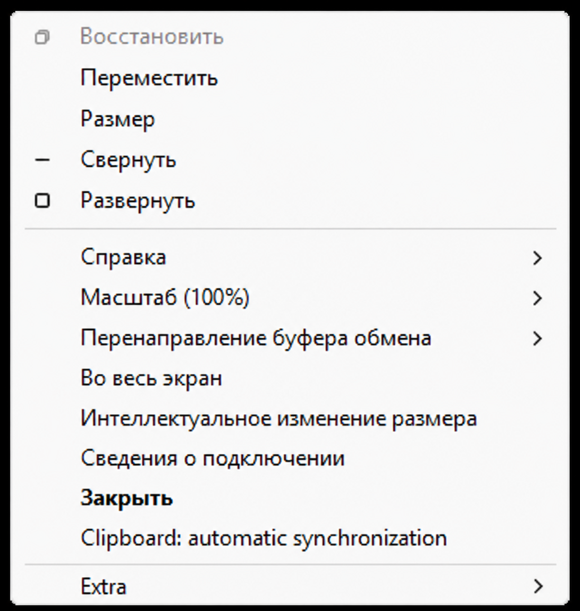

# MSTSC Clipboard On/Off

[English (default)](README.md)

Ориентированный на приватность запуск Microsoft Remote Desktop Connection. Приложение сохраняет привычный интерфейс
`mstsc.exe`, профили `.rdp` и штатный движок Microsoft RDP, но добавляет переключатель автоматической синхронизации
буфера прямо во время сеанса.

Каждое новое подключение начинается с **выключенной** автоматической синхронизации. Включайте её только тогда, когда
действительно нужно перенести данные между локальным и удалённым компьютерами.

> Правило приватности: по умолчанию держите синхронизацию выключенной и включайте её только для нужной передачи.



Проект является специализированным форком
[Devolutions/MsRdpEx](https://github.com/Devolutions/MsRdpEx).

## Как это работает

- `mstscex.exe` запускает оригинальный Microsoft `mstsc.exe` через `MsRdpEx.dll`.
- Окно настройки MSTSC и встроенные функции клиента остаются доступными.
- До подключения включается ручной режим буфера Microsoft RDP ActiveX.
- В начале каждого подключения автоматическая синхронизация выключена.
- В системном меню окна появляется пункт **Clipboard: automatic synchronization**.
- Галочки нет — синхронизация выключена; галочка есть — включена.
- При включении возвращается штатная автоматическая синхронизация MSTSC, поэтому текст и файлы передаются через
  стандартный канал буфера RDP.

Штатная настройка **Локальные ресурсы → Буфер обмена** должна оставаться включённой. Она разрешает канал RDP, а новый
переключатель управляет синхронизацией во время сеанса.

## Сборка и установка

Требуются Windows 10/11, Visual Studio 2022 с компонентом **Разработка классических приложений на C++** и CMake.

```powershell
cmake -G "Visual Studio 17 2022" -A x64 -DWITH_DOTNET=OFF -B build-x64
cmake --build build-x64 --config Release
powershell -NoProfile -ExecutionPolicy Bypass -File .\scripts\package-clipboard-onoff.ps1
```

Готовый каталог появится в `dist\mstsc-clipboard-onoff`. Файлы `mstscex.exe` и `MsRdpEx.dll` должны находиться рядом.
Затем выполните:

```powershell
cd .\dist\mstsc-clipboard-onoff
.\Register-RDP-App.cmd
```

Откроются параметры Windows: система требует, чтобы пользователь сам выбрал приложение по умолчанию для `.rdp`.
Выберите **MSTSC Clipboard On/Off**. Регистрация выполняется только для текущего пользователя и не требует прав
администратора.

## Использование

1. Откройте `.rdp`-файл через **MSTSC Clipboard On/Off**.
2. Подключитесь как обычно через интерфейс MSTSC.
3. Откройте системное меню окна комбинацией `Alt+Space` либо правой кнопкой по панели подключения в полноэкранном
   режиме.
4. Только когда нужна передача, включите **Clipboard: automatic synchronization**.
5. При копировании файлов дождитесь полного завершения операции.
6. После передачи снова выключите синхронизацию.

Новое подключение всегда начинается без галочки. Выключение останавливает последующую синхронизацию, но не удаляет
данные, уже попавшие в один из буферов.

## Редактирование RDP-файла

Скрипт регистрации также создаёт пункт **Отправить → Изменить RDP**. Он открывает выбранный файл в штатном редакторе
Microsoft (`mstsc.exe -edit`), не меняя приложение по умолчанию.

В Windows 11 сначала нажмите **Показать дополнительные параметры**, затем **Отправить → Изменить RDP**.

Чтобы добавить только этот ярлык, выполните:

```powershell
powershell -NoProfile -ExecutionPolicy Bypass `
    -File .\packaging\mstsc-clipboard-onoff\Add-RdpEditSendTo.ps1
```

## Настройка

Если переменная не задана, `mstscex.exe` устанавливает `MSRDPEX_MANUAL_CLIPBOARD_SYNC=1`. Чтобы временно вернуть
исходную автоматическую работу буфера и скрыть добавленный пункт меню:

```powershell
$env:MSRDPEX_MANUAL_CLIPBOARD_SYNC = '0'
.\mstscex.exe
```

В `.rdp`-профиле оставьте `redirectclipboard:i:1`. Если канал буфера запрещён настройкой клиента или политикой
сервера, переключатель не сможет обойти это ограничение. См. [пример профиля](examples/clipboard-private.rdp).

## Удаление

Запустите `Unregister-RDP-App.cmd`. Скрипт удаляет только регистрацию этого приложения для текущего пользователя и
его ярлык в меню «Отправить». Если приложение было назначено обработчиком `.rdp`, снова выберите штатное «Подключение
к удалённому рабочему столу» в параметрах Windows.

## Приватность и ограничения

- Пока синхронизация выключена, новые изменения буфера не передаются автоматически через RDP.
- После включения содержимое буфера может передаваться через RDP в обе стороны.
- Выключение синхронизации не очищает локальный или удалённый буфер.
- Групповые политики сервера и локальные настройки перенаправления RDP продолжают действовать.
- Текстовый буфер вручную проверен в x64 Windows. Передача файлов теперь использует штатную синхронизацию MSTSC;
  передача файлов и другие архитектуры требуют дополнительной ручной проверки.
- Приложение не изменяет и не завершает `rdpclip.exe` на удалённом компьютере.

## Лицензия и исходный проект

Проект распространяется по [лицензии MIT](LICENSE). Код основан на MsRdpEx от Devolutions с сохранением лицензии и
уведомлений об авторских правах. Документация исходного проекта и полный набор возможностей MsRdpEx доступны в
[оригинальном репозитории](https://github.com/Devolutions/MsRdpEx).
